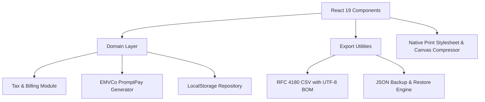

# System Architecture: Multi-Income Billing and Tax Tracker

This document explains the technical architecture, domain boundary rules, and financial calculation models used in the application.

---

## 1. High-Level Architecture

The application runs entirely on the client as a Single Page Application (SPA). It requires no external backend server, database, or cloud storage.



### Key Architectural Decisions

* **Client-side isolation.** All sensitive financial records, client Tax IDs, and payment slips remain on the user's device. No financial data transmits over third-party networks.
* **Deterministic domain functions.** Calculation logic for Withholding Tax (WHT), P.N.D. 90 grouping, and EMVCo payload formatting are pure functions with zero DOM dependencies.
* **Native browser features over bloated dependencies.** Canvas API handles image compression. Web Blob API handles CSV and JSON exports. CSS print media queries handle PDF generation.

---

## 2. Domain Models and Boundaries

The domain logic resides in `src/domain/`.

### 2.1 Tax Categorization (`src/domain/tax.ts`)

Thai personal income tax law divides revenue into categories under Section 40 of the Revenue Code. This application models three primary categories for multi-income earners:

| Code | Revenue Category | Default Expense Deduction Rule |
|---|---|---|
| `40_2` | Section 40(2) Service / Freelance | 50% deduction capped at 100,000 THB combined with Section 40(1) salary |
| `40_6` | Section 40(6) Liberal Professions | 30% or 60% deduction (medical 60%, legal/engineering/architect 30%) |
| `40_8` | Section 40(8) Commerce / Content / Other | 60% standard deduction or actual proven expenses |

### 2.2 Financial Calculations

```ts
subtotal = sum(item.quantity * item.unitPrice)
whtAmount = round(subtotal * 0.03)
netTotal = subtotal - whtAmount
```

* `roundCurrency(val)` rounds to 2 decimal places to prevent floating-point discrepancies.
* The 3% Withholding Tax is calculated on `subtotal` before any applicable VAT (non-VAT registered freelancers cannot charge VAT).

### 2.3 PromptPay QR Code Payload Generator (`src/domain/promptpay.ts`)

The QR code generator adheres to the EMVCo Merchant-Presented QR standard:

1. **Tag 00 (Format Indicator):** `01`
2. **Tag 01 (Initiation Method):** `12` (Dynamic amount included) or `11` (Static without amount)
3. **Tag 29 (Merchant Account Information - PromptPay):**
   * Subtag 00: PromptPay AID `A000000677010111`
   * Subtag 01: Mobile number formatted to 13 digits (`0066...`) or National ID (13 digits)
4. **Tag 53 (Currency):** `764` (Thai Baht)
5. **Tag 54 (Transaction Amount):** Two decimal string (e.g., `43650.00`)
6. **Tag 58 (Country Code):** `TH`
7. **Tag 63 (CRC Checksum):** CRC-16/CCITT-FALSE (Polynomial `0x1021`, initial value `0xFFFF`, padded to 4 hexadecimal characters)

---

## 3. Storage Layer (`src/domain/storage.ts`)

The application persists data using `localStorage`:

* `thai_freelancer_invoices`: JSON array of invoice objects.
* `thai_freelancer_issuer`: JSON object containing payee name, tax ID, bank information, and PromptPay ID.

### Backup and Restore Schema Version 1

```json
{
  "app": "thai_freelancer_billing",
  "version": 1,
  "exportedAt": "2026-10-27T16:29:00.000Z",
  "issuer": { ... },
  "invoices": [ ... ]
}
```

The validation layer (`validateBackupPayload`) verifies that imported JSON files match the expected application identifier and validate invoice primary keys before modifying local storage.
